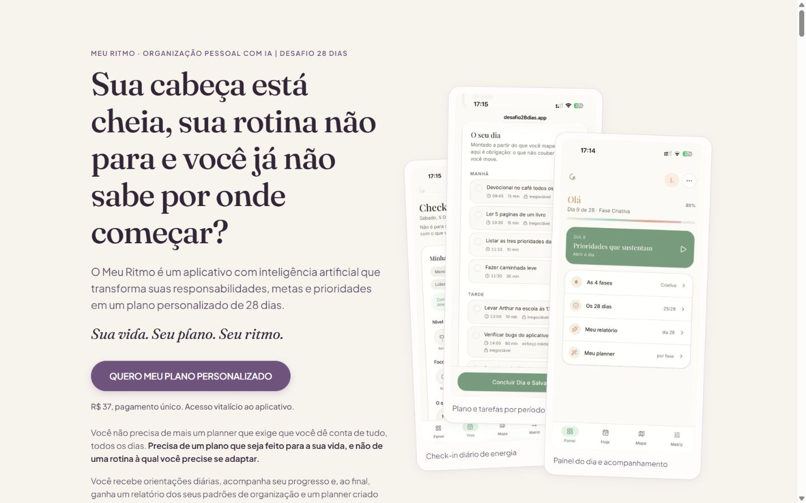
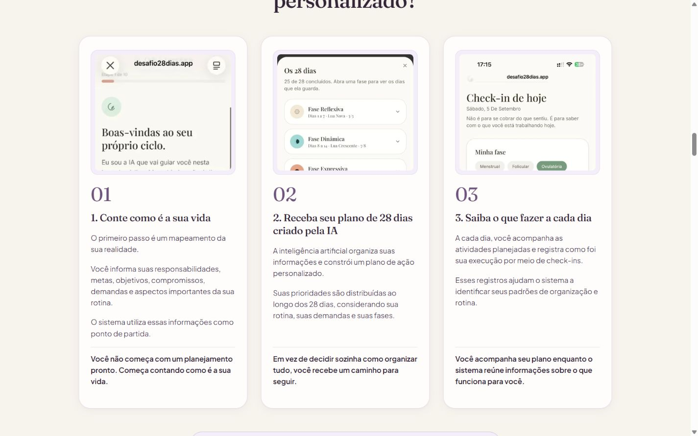
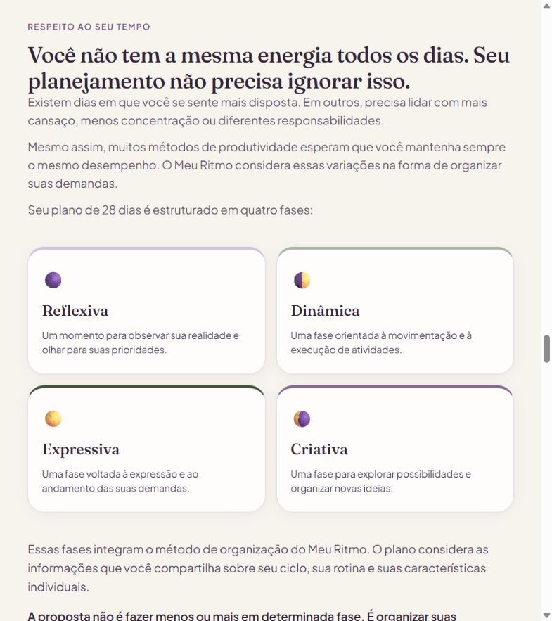
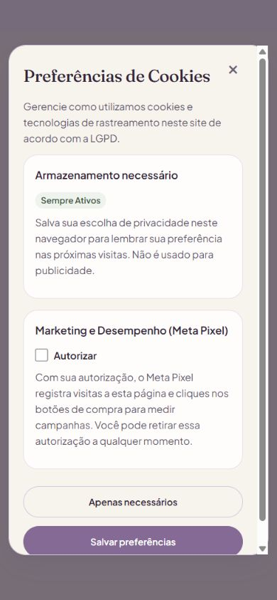

# Verificação do refinamento — Meu Ritmo

Data: 22/10/2026. Escopo: versão local de `index.html`, seus recursos e comportamento no navegador. A verificação documentada foi executada localmente, antes do envio ao GitHub.

**Atualização tipográfica posterior, aprovada pelo usuário:** Fahkwang substituiu Fraunces nos títulos e destaques; Livvic substituiu Plus Jakarta Sans nos textos e controles. A página usa pesos 400 (regular) e 500 (médio), inclusive nos trechos de ênfase, sem pesos finos. As 13 larguras de 320 a 1920px foram verificadas novamente, sem conteúdo ultrapassando as laterais. As medidas atuais estão em `medidas-tipografia.json`; as capturas atuais são `tipografia-celular.jpg` e `tipografia-computador.jpg`. As demais capturas e a comparação antes/depois abaixo documentam a etapa anterior do refinamento.

Os problemas técnicos identificados nesta revisão foram corrigidos e os testes descritos abaixo passaram. O relatório recebido continha afirmações que não correspondiam à implementação. Esta verificação distingue o comportamento observado das informações que dependem do responsável pelo negócio.

## Refinamento visual aplicado

- Definidas as medidas ausentes `--e28: 28px` e `--e36: 36px`. Isso recupera preenchimento de cartões, modais e destaque editorial, separação das etapas e espaço após respostas do FAQ.
- Etapas com preenchimento de 28px × 24px e distância de 28px entre cartões.
- Fases em uma coluna abaixo de 600px, duas entre 600px e 1023px e quatro a partir de 1024px.
- CTA inicial reposicionado após a apresentação do produto e o slogan. O conteúdo complementar foi mantido abaixo do botão e do preço.
- Paleta oficial e fontes Fraunces / Plus Jakarta Sans mantidas. O detalhe pêssego remanescente foi substituído por sálvia escura.
- Links e pequenos rótulos usam `--acao-texto: #6E537D`; legendas usam `#6E5F78`. A cor original `#846A94` continua nos fundos dos botões.
- Modais com preenchimento, limite de altura, rolagem interna, espaço reservado ao botão de fechar e quebra de texto em telas pequenas.
- Controles de cookies e rodapé com áreas de interação de pelo menos 44px de altura.

Comparação do topo do primeiro botão, medida desde o início da página, sem o banner de cookies:

| Tela | Antes | Depois |
| --- | ---: | ---: |
| 320px | 1001px | 585px |
| 390px | 836px | 499px |
| 1440px | 934px | 645px |

Os números são da simulação no navegador desktop, com sua barra de rolagem. Não representam medidas em aparelhos físicos. Em telas baixas, especialmente na orientação horizontal, continua sendo necessário rolar a página.

## Auditoria dos 17 itens

| Nº | Item | Verificação e resultado |
| --- | --- | --- |
| 1 | Política de Privacidade | Modal existente, aberto e testado em 320px. Texto corrigido para explicar a ausência de formulário, o armazenamento da preferência e os eventos do Pixel. Retirada a afirmação de que esses eventos são anônimos. O contato foi chamado de canal de privacidade, sem atribuir um DPO não confirmado. Identificação do responsável e revisão da operação do aplicativo permanecem pendentes. |
| 2 | Termos de Uso | Modal funcional; natureza do aplicativo, pagamento único e limitações estão presentes. A execução real do serviço e a adequação integral dos termos não podem ser certificadas por esta revisão da landing page. |
| 3 | Cookies | Corrigido o botão “Salvar preferências”: agora respeita a caixa desmarcada. Recusa não carrega o Pixel; alteração e revogação são aplicadas ao estado da página. O texto descreve o armazenamento realmente utilizado. |
| 4 | Reembolso | Incluído link direto para o portal da Kiwify, instrução de usar o e-mail da compra e explicação de que recebimento depende do meio de pagamento. Corrigida a afirmação de estorno de boleto na mesma forma de pagamento. Não foi realizada uma compra ou solicitação de reembolso. |
| 5 | Formulários | Nenhum elemento `form` na landing page. A caixa de autorização de marketing é uma preferência local. Checkout externo preservado. |
| 6 | Minimização | Não foi identificado formulário de ciclo, rotina ou captura de leads nesta página. Esse resultado não é uma auditoria da coleta feita dentro do aplicativo ou da hospedagem. |
| 7 | Tracking | ID `735853032032044` preservado. Inicialização protegida por consentimento. PageView único na inicialização e InitiateCheckout condicionado à autorização. Ao revogar, enviado comando `consent/revoke` ao SDK, bloqueados novos eventos explícitos e removidos cookies próprios `_fbp` e `_fbc` acessíveis à página. Mudanças de preferência em outra aba são refletidas. |
| 8 | Acessibilidade geral | Atalho de navegação com destino focalizável, diálogos identificados, foco visível e controles maiores. Não se declara certificação integral WCAG 2.2 AA: não foram realizados testes com leitores de tela reais, Safari/iOS ou auditoria de alternativas para todo o conteúdo do vídeo. |
| 9 | Textos alternativos | Todas as 12 imagens têm texto alternativo não vazio. Corrigido o alt do painel, que mencionava dia/progresso diferentes da captura mostrada. Demais descrições mantidas. |
| 10 | Contraste | Combinações de textos pequenos e fundos dos tokens testados passam em 4,5:1. Botão `#846A94` com texto `#FFFDFB`: aproximadamente 4,63:1; texto de ação `#6E537D` sobre creme: 5,94:1; sobre lavanda oficial: 4,61:1. As taxas do relatório original não eram todas exatas. Contraste dentro de imagens não foi certificado. |
| 11 | Teclado | Tab e Shift+Tab permanecem no diálogo; Escape fecha; foco retorna ao acionador. Se o acionador era um banner que desapareceu, o foco vai para o conteúdo principal. Fundo inerte e rolagem travada durante o modal. FAQ testado com Enter e Espaço. Barra móvel fora da tela fica inerte. |
| 12 | Avaliações falsas | A versão atual não contém a seção de depoimentos citada no relatório. Nenhum depoimento, estrela, nome ou relato foi inventado para preencher essa diferença. |
| 13 | Promessas | Avisos de ferramenta de organização e de não substituição de acompanhamento de saúde presentes. Não há promessa de cura adicionada nesta revisão. A aderência das funcionalidades anunciadas ao aplicativo depende de validação do produto. |
| 14 | Direitos de imagens | Os 19 caminhos de mídia referenciados por imagens, sources e poster existem localmente. Isso comprova disponibilidade dos arquivos, não titularidade, licença ou autorização das pessoas/dados eventualmente retratados. |
| 15 | Identificação do fornecedor | Pendente por decisão expressa do usuário: razão social, CPF/CNPJ e endereço não foram inseridos, nem substituídos por dados fictícios. Canal já existente `suporte@desafio28dias.app` mantido; nenhum novo e-mail foi presumido. |
| 16 | LGPD operacional | Direitos e canal de solicitação estão descritos; revogação técnica corrigida. Identificação do controlador/encarregado, fornecedores de IA, retenção dos dados do app e processos internos de atendimento continuam sujeitos à definição e validação do negócio. |
| 17 | Alinhamento com Kiwify | Link oficial de checkout, R$ 37 e oferta de pagamento único preservados. Procedimento de reembolso conferido na documentação oficial. Configurações privadas do produto, entrega e garantia no painel Kiwify não foram acessadas. |

A identificação do fornecedor inclui informações de nome, inscrição e endereços físico e eletrônico; omiti-las não permite considerar esse item concluído. Referência: [Decreto 7.962/2013, art. 2º](https://www.planalto.gov.br/ccivil_03/_ato2011-2014/2013/decreto/d7962.htm).

A retirada de consentimento deve ser facilitada. A correção técnica segue essa orientação, mas não elimina retroativamente dados já enviados. Referências: [direitos dos titulares — ANPD](https://www.gov.br/anpd/pt-br/assuntos/titular-de-dados-1/direito-dos-titulares) e [guia de cookies — ANPD](https://www.gov.br/anpd/pt-br/centrais-de-conteudo/materiais-educativos-e-publicacoes/processo-guia-orientativo-cookies-e-protecao-de-dados-pessoais.pdf).

O procedimento de reembolso foi ajustado a partir das páginas oficiais [solicitação pelo comprador](https://ajuda.kiwify.com.br/pt-br/article/como-faco-para-pedir-o-reembolso-de-um-produto-que-comprei-1kfom3h/) e [processamento por meio de pagamento](https://ajuda.kiwify.com.br/pt-br/article/como-reembolsar-a-compra-de-um-cliente-1j71zt7/), além do [CDC, art. 49](https://www.planalto.gov.br/ccivil_03/leis/l8078compilado.htm).

## Diferenças em relação ao relatório recebido

- A página tem **cinco** CTAs de compra: abertura, apresentação do produto, oferta, chamada final e barra móvel. Todos apontam para `https://pay.kiwify.com.br/NXZ0sjz` e têm um acionamento explícito do evento. A barra móvel anteriormente apontava apenas para `#oferta`; foi alinhada ao checkout conforme o relatório.
- Não havia fallback de Pixel em `noscript` na versão recebida. Não foi adicionado um rastreador sem JavaScript, que dispararia sem passar pelas escolhas de consentimento.
- Correção da auditoria após a publicação: além das versões JPG/WebP, o HTML referencia `IMG_4719.PNG`, `IMG_4720.PNG` e `IMG_4722.PNG`. Esses três arquivos existiam localmente, mas ficaram fora do commit inicial, causando imagens quebradas na hospedagem. Foram incluídos no Git na correção. `IMG_4721.PNG` e `IMG_4723.PNG` não são referenciados e continuam preservados apenas localmente.
- Não há dupla associação de evento por listener e onclick. O acionamento explícito permanece somente nos atributos onclick dos cinco CTAs.
- A aplicação de `main`, `section`, `footer` e diálogos foi conferida; a ausência de um `header` separado não foi tratada como falha por si só.

## Validação executada

**Navegador:** 320, 360, 390, 430, 600, 768, 800, 960, 980, 1024, 1366, 1440 e 1920px. Nenhum elemento do conteúdo principal ultrapassou horizontalmente a área disponível nas medições. Quatro modais testados em 320px, sem rolagem horizontal. Preferências também testadas em 844 × 390px. Medidas salvas em `medidas-responsivas.json` e `modais-320px.json`.

**Interação:** primeira visita exibe aviso; caixa de marketing começa desmarcada; salvar desmarcada fecha a janela e mantém zero scripts da Meta no DOM; preferência recusada permanece após recarregar. Tab/Shift+Tab, Escape, retorno de foco, fundo inerte, FAQ e atalho de navegação verificados. Nenhum erro de console observado na aba final.

**Testes automatizados:** `node --test tests/landing-regression.cjs` — 10 testes aprovados após a correção das imagens. Cobrem ausência de rastreamento sem autorização, handler real de salvar preferências, inicialização única, revogação, renovação, armazenamento indisponível, sincronização entre abas, variáveis CSS, mídia, checkout e contraste. A nova verificação exige que os recursos locais referenciados também estejam no índice do Git, com maiúsculas/minúsculas correspondentes; ela detectou os três PNGs ausentes antes da inclusão. `git diff --check` aprovado.

Os testes de aceite e revogação executam os scripts reais da página com DOM/armazenamento e fila do SDK simulados, sem transmitir eventos de teste à conta Meta. A recepção de eventos no Gerenciador de Eventos e o comportamento do SDK externo não foram validados nesta sessão. O teste no navegador confirmou o fluxo de recusa e a ausência do carregamento do SDK nesse fluxo.

## Evidências visuais

